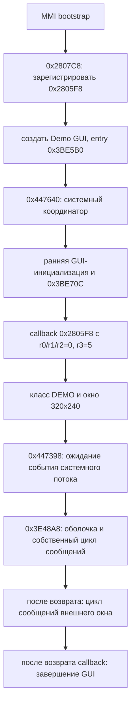

# Этап 3: реальный GUI callback, NGame и таблица native API

## Что получено

Воспроизводимый экспорт расширен с 57 до **99 функций**: RedBoot v3 — 27,
v1 — 4, MMI — 68. Это 42 дополнительных функции относительно этапа 2,
а не полная декомпиляция образов. Все исходные GZF/RAP/PRAW сохранили хеши.
Исходные GZF импортируются в временные базы; публикуется выбранный текст,
а не исходные образы или базы.

Две неверные границы функций в GZF объединены по ARM-прологам, ветвлениям,
общему стековому кадру и конечным эпилогам. Исправлено неверное продолжение
планировщика в пул литералов: context-restore помечен noreturn по реальному
восстановлению PC/CPSR. Сами машинные инструкции не менялись.
`ghidra_targets.json` фиксирует все операции и ожидаемые слова оригинала.

Успешный экспорт означает получение текста, а не полную достоверность C.
Предупреждения декомпилятора сохранены в `export_summary.json` в
`pseudocode_warnings`. Исходный язык GZF остаётся ARM v8, целевой CPU — ARMv5TE;
системные регистры по-прежнему сверяются по ARM-коду вручную.

## 1. Где находится цикл GUI

`0x2807C8` до создания Demo GUI вызывает setter `0x3BE5A0`, передавая
`0x2805F8`. Setter сохраняет callback по `0x560C18`.



В 0x2805F8 регистрируется оконный класс через 0x280590, создаётся окно,
выполняются графические операции и вызывается ожидание события 0x68E4D0
с mask=1, mode=2. Как показано этапом 2, это уведомление выставляется и
после исчерпания попыток, поэтому само ожидание не доказывает успех подсистем.

Затем вызывается 0x3E48A8. В нём есть собственный message loop:
get_message → translate_message → 0x3E1C4C (диспетчер оболочки).
После возврата из этой функции внешний цикл по 0x280790 выполняет:

- 0x3BF470 — получение сообщения до появления результата;
- 0x3BF4C4 — преобразование сообщения;
- 0x3BF500 — диспетчеризация.

GetMessage возвращает false для message.type=0x12. Поля message-prefix:
window по +8, type по +0xC, аргументы по +0x10/+0x14. Полный размер объекта
пока не установлен. Translate преобразует тип 0x100 в вызов с типом 0x102;
назначение этих чисел как клавиатурных событий вероятно, но требует трассировки ввода.

Предварительные имена `mmi_gui_dispatch` (0x3BE6C0) и `mmi_gui_run_impl`
(0x3BE9E4) из предыдущего этапа уточнены: это shutdown-wrapper и shutdown,
а не обработчик сообщений. После окончания зарегистрированного callback
вызывается освобождение GUI-ресурсов и exit(0).

**Следствие:** замена callback сама по себе пропустит создание окна и часть
оболочки. Нельзя считать этот указатель готовым безопасным hook для SPMP-OS.
Его также перезаписывает штатная регистрация при запуске GUI.

## 2. Исправленные границы native-функций

| Настоящее начало | Ложная внутренняя граница | Конец машинного кода |
|---|---|---|
| 0x460120, загрузчик n1.bin | 0x46018C | 0x460260 exclusive |
| 0x4617E4, загрузчик NGame | 0x4618C4 | 0x4618F0 exclusive |

0x46018C — продолжение ROMFS fallback в том же кадре функции. 0x4618C4
использует r4, вычисленный внешним кодом; это сравнение footer, а не отдельная
функция с самостоятельным ABI. После объединения восстановились параметры
и обработка ошибок, потерянные при старой декомпиляции.

Кроме того, 0x33C144 вызывает context-restore 0x4AE52C. По 0x4AE544
восстанавливаются r0–lr, затем MOVS pc,lr возвращает сохранённый контекст.
Продолжение по 0x33C148 — литерал 0x0063E0F8, а не исполняемая инструкция.
Пометка noreturn в рабочей базе убрала ложный halt_baddata из scheduler-start.

## 3. Что действительно проверяет NGame

Ветка `.BIN`:

```text
Game thread → 0x460800 → 0x4617E4
→ чтение файла → разбор NGame → преобразование префикса → сравнение footer
→ инициализация native API/звука → вызов кода по 0x00A00000
```

В запросе 0xD01 обработчик 0x2D3D38 создаёт Game thread с priority=24,
entry=0x460AB0. Выбор ветви в потоке зависит от расширения имени.
Маршрут .BIN и встроенный n1.bin — разные загрузчики с разными параметрами входа.

Проверка заголовка 0x4611BC:

1. Сравниваются первые 5 байт с `NGame` через временную NUL-terminated копию.
2. Размер заголовка принимается равным 0x80.
3. Слово uint32 LE по +0x78 задаёт размер исключаемого хвоста/дополнительных данных.
4. payload_length = file_size - 0x80 - tail_size.
5. Всё содержимое после заголовка сдвигается на его место.

Байт +0x6D выводится как LCM resolution index, но в этой функции не участвует
в решении принять/отклонить файл. Это не доказывает, что его не проверяют позже.

0x461130 преобразует первые min(payload_length,1024) байт. Используются
8-байтный ключ `n-p*8KGM`, аргумент mode=1 и независимые 8-байтные блоки.
Затем сравнивается строка по payload+payload_length-16 с
`SUNPLUS556GAME\0` (14 символов и NUL). Проверка происходит **после** преобразования.

Это DES-подобная реализация со стандартными таблицами, но с LSB-first
нумерацией битов, LSB-first выходом S-box и без обычной финальной перестановки
половин. Прямая замена на стандартную DES-библиотеку не подтверждена.
Восстановленный Python-алгоритм совпал с оригинальным ARM на 14 проверках:
разные ключи, mode=0/1 и длины 8, 16, 24, 64, 128, 1024 байта.
Ветка 16-байтного ключа в OEM-коде существует, но для NGame используется 8;
ветка с двумя ключами в host-инспектор не включена.

OEM округляет число обрабатываемых блоков вверх, но временный буфер выделяет
по неокруглённому размеру. Поведение коротких невыровненных данных небезопасно
воспроизводить буквально. Host-инспектор такие длины отвергает дополнительной
проверкой границ. Он также отсекает underflow размеров и слишком короткий payload.
Это дополнительные проверки инструмента, а не восстановленные отказы OEM.

Ошибки заголовка, преобразования и footer в 0x4617E4 превращаются в код 5;
ошибки параметров/чтения — в 2. Внешний BIN-loader сводит ненулевой результат
к -2. Проверка чтения файла 0x45FFCC также требует дальнейшей ревизии:
размер сравнивается с capacity строго через `<`, а возврат зависит от close;
отказ копирования не всегда выражен отдельным конечным кодом.

**Что умеет инструмент:** `tools/ngame_inspect.py` проверяет этот структурный
путь с ограничением размеров и декодированием префикса. `structural_match`
означает только совпадение исследованных предикатов. Он не подтверждает
исполняемость ARM-кода, API, RAM или совместимость с консолью. Для длинного
payload footer находится вне преобразованного префикса; наличие такого маркера
не проверяет корректность первых инструкций.

Ранее отвергнутый экспериментальный BIN отсутствует в этом архиве как
идентифицированный вход, поэтому точная причина его отказа не установлена.
Генератор загрузочного пакета или образ для записи не создавался.

## 4. Native API и вход BIN

После успешной структурной проверки 0x460800 вызывает:

- 0x2D32B0 — построение таблицы API по 0x5EFB74;
- 0x4628B8 — `NativeGE_startSound`, в том числе создание Midi Seq thread;
- настройку callback-таблицы и отправку штатных команд;
- обычную ARM-передачу управления по 0xA00000 через MOV lr,pc; MOV pc,r5,
  передав **r0=0x5EFB74**.

r1/r2/r3 в точке вызова явно не задаются как аргументы приложения. После
возврата следуют native_exit_control, команды завершения и очистка в Game thread.
Нормальный возврат из BIN предусмотрен статическим кодом; возвращение после
произвольного сбоя или повреждения RTOS не доказано.

Таблица содержит **85 uint32 слотов**, размер 0x154:

| Класс записи по ARM-коду | Количество |
|---|---:|
| Функции, для которых ещё нет полного ABI | 56 |
| Заглушки `return -2` | 21 |
| Заглушки `return 0` | 5 |
| Голый `BX LR`, без установки результата | 2 |
| NULL | 1 |

Карта всех слотов: `evidence/native_api_slots.csv` и `stage3_verified.json`.
Примеры: +0x11C указывает на eCos delay-wrapper 0x339BE8; +0x124 — функцию
относительного времени 0x2D3254; +0x150 — NULL. Сигнатуры большинства слотов
ещё не восстановлены. +4 указывает на диагностический stub 0x298B64, а не
доказывает наличие работающего printf.

Статическая карта **полностью совпала с результатом исполнения оригинального
инициализатора в Unicorn**. В этой отдельной VM только чтение часов 0x339D18
заменено на возврат нуля; все записи в 85 слотов выполнял оригинальный ARM-код.
Отчёт: `evidence/native_arm_emulation.json`.

Таблица native BIN и пять символов загрузчика RedBoot customize — разные API.
Нельзя переносить адреса, форматы и предположения об ABI между ними.

## 5. RedBoot: уточнение backend и структур

Module-open 0x40A14 выбирает backend по младшему байту второго аргумента:
0 — файл, 3 — память. В режиме памяти длина передаётся из оставшихся битов
через арифметический сдвиг на 8. Другие значения не являются подтверждёнными
поддержанными режимами.

Восстановлен 48-байтный descriptor с source/backend/cursor/length,
адресами read/seek/close, ELF header, section headers, индексами symtab/strtab
и кэшем размещённых секций. Числовые layouts: `src/oem_layouts.h`.
Это структуры с uint32-адресами, не готовые bindings для вызова на устройстве.
Политика размещения, нулевой инициализации .bss/COMMON и допустимые импорты
ещё требуют исследования до создания рабочего customize-модуля.

## 6. Практическое направление SPMP-OS

Наиболее конкретным стал путь отдельного NGame/BIN-приложения MMI:
установлены контейнерные предикаты, преобразование префикса, entry и указатель API,
а штатная оболочка предусматривает возврат и очистку. Следующий необходимый этап —
восстановление сигнатур слотов дисплея, клавиш, памяти, файлов и управления звуком,
а также обязательств callee по стеку и сохранению контекста.

Пока нет проверенного запуска на Defender, собственного HAL, подтверждённого
кармана свободной RAM или готовой прошивки. Оригинальные RedBoot/MMI не менялись.

## Проверки и воспроизведение

```sh
make -C research/boot_reconstruction test
python3 research/boot_reconstruction/tools/ngame_inspect.py /path/to/local/game.bin
python3 research/boot_reconstruction/tools/audit_stage3.py /path/to/private/archive-root --output research/boot_reconstruction/build/stage3.json
```

Последняя проверка сверяет 37 ARM callsites/слов, 8 таблиц и 85 слотов.
Для изолированного сравнения с оригинальным ARM нужен локальный RAP и Unicorn:

```sh
python3 -m venv work/emu-venv
work/emu-venv/bin/pip install -r research/boot_reconstruction/requirements-emulation.txt
work/emu-venv/bin/python research/boot_reconstruction/tools/emulate_native_prefix.py \
  --rap /path/to/local/8000_MMI.RAP --output research/boot_reconstruction/build/emulation.json
```

В VM отображаются только код/данные RAP и рабочая RAM. Нет MMIO, syscalls или
доступа к устройству. Исполнение ограничено числом инструкций и timeout.
Эмуляция криптофункции и инициализатора API не является эмуляцией всей консоли.
