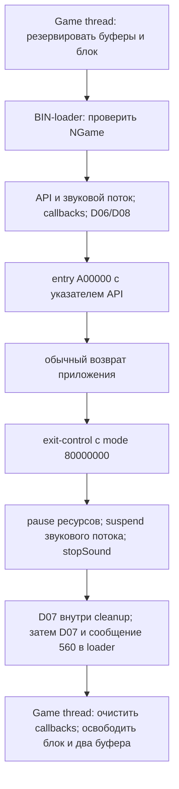

# Этап 5: память Game thread, ресурсы звука и возврат BIN

Экспорт расширен с 170 до **206 выбранных функций**: MMI — 175, RedBoot v3/v1 —
27/4. Новые 36 функций относятся к MMI, allocator, RTOS и звуковому тракту;
нового анализа RedBoot на этом этапе нет. Это выбранный псевдокод и ARM,
не полные собираемые исходники OEM.

Добавлены 7 объявлений resource/exit API, вместе с этапом 4 — **24 объявления**
подмножества 85-слотовой таблицы. Типы в
[`src/mmi_native_resources_abi.h`](src/mmi_native_resources_abi.h) не привязаны
к живым адресам. Модели: `tools/native_lifecycle_models.py`.

## Достоверность

Все адреса относятся только к RAP SHA-256
`5529b173b3fb612b2e7f516af807f1342d24ea6f7101be034e1e0d08fed25c4e`.
Свежий экспорт Ghidra 12.2 проверил mapped bytes; оригинальные три GZF сохранили
суммы. Предупреждения сохранены в `decompiled/export_summary.json`. Новых
исправлений границ или машинных инструкций нет. Язык баз остаётся ARM v8;
цель — ARMv5TE, системные инструкции сверены по ARM вручную.

`audit_stage5.py` выполнил **75 точных ARM-проверок**, извлёк 21 constructor
и сопоставил 7 объявлений со слотами. `emulate_native_lifecycle.py` выполнил
**119 сценариев оригинального ARM в Unicorn**, включая:

- настоящий constructor игрового пула, allocator/info/free и восстановление
  свободного пространства после coalescing;
- весь Game thread с контролируемым результатом BIN-loader;
- resource lookup, WAV parser, состояния каналов, выбор workspace и initRes;
- несколько итераций настоящего аудиопотока до первого submit/idle;
- путь Game thread → BIN-loader → подставная точка входа → штатная очистка.

Scheduler unlock, файловое чтение, MIDI decoder/sample backend, PCM-драйвер,
создание/управление потоками и cache-prepare подменяются явно там, где они
достигаются. MMIO не отображается. Прочие startup constructors заменены
заглушками; проверяется порядок обхода и реальный constructor пула, не весь boot.
Тестовая точка входа возвращает заданное число, она не является рабочей игрой
или пакетом NGame. В VM не загружается настоящий payload и не работает RTOS.
Обычные возвращающиеся функции проверяются на SP/r4–r11; бесконечный worker
наблюдается ограниченно и не объявляется возвращающейся функцией.

Свидетельства: `evidence/stage5_verified.json`,
`evidence/native_lifecycle_arm_emulation.json`. Ни физическая RAM, ни реальные
LCD/PCM, ни сохранность контекста при вытеснении этими тестами не удостоверены.

## 1. Игровой пул создаётся до запуска оболочки

MMI reset вызывает `0x299A98`. Он обходит таблицу function pointers
`[0x56AD08,0x56AD5C)` в обратном порядке. Всего 21 запись; последний вызов —
`0x2E3908`, записанный в первом элементе таблицы. Этот thunk вызывает
`0x2E3898(1,0xFFFF)`, затем `0x32E594` → constructor `0x4CDFF0`:

| Параметр | Значение из оригинала |
|---|---|
| Объект пула | 0x606348, в BSS MMI |
| Начало переданной области | 0x009FFF00 |
| Конец exclusive | 0x02000000 |
| Запрошенное выравнивание | 8 |
| Эффективное выравнивание allocator | 16: увеличивается выше размера header 12 |

Это конфигурация оригинального пула, а не доказательство наличия 32 МиБ RAM
у любой ревизии консоли. Пул содержит служебные header; его диапазон нельзя
полностью объявлять свободной памятью приложения.

Info `0x2E37C0` получает статус с flags=0x5E. Поле **+0x28** в 44-байтном
результате — максимальный запрос: размер крупнейшего свободного блока минус
12 байт. Поля +0x1C/+0x20 отражают использованный/свободный extent с учётом
allocator overhead. Обёртка переносит только положительные значения; это не
обычная сумма «байтов, доступных malloc». Семантика остальных полей не объявлена.

## 2. Что действительно резервирует Game thread для BIN

Для kind=6 он выделяет два блока по 0x25800 (320×240×2), затем берёт max_request
из info и выделяет основной блок. Allocator отрезает блоки с верхнего края
свободной области. На **свежем пустом пуле** оригинальный ARM дал:

| Объект | Адрес/размер |
|---|---|
| Первый графический буфер | 0x01FDA7F0, запрос 0x25800 |
| Второй графический буфер | 0x01FB4FE0, запрос 0x25800 |
| Основной блок | 0x009FFF10, запрос 0x015B50C4 |
| Entry BIN | 0x00A00000, на 0xF0 выше начала основного блока |
| Аргумент capacity загрузчику | 0x015B4FD4 |

Формула capacity: `allocated_base + max_request - 0xA00000`, uint32.
Это аргумент нижнего файлового загрузчика, а не готовый бюджет heap или
максимальный размер декодированного тела. Как установлено этапом 3, нижняя
проверка относится к размеру файла и использует строгое `<`.

При двух дополнительных предварительных размещениях адреса/размеры менялись
согласно реальному allocator. После освобождения основной области и буферов
free/max_request восстановились. Адреса из таблицы не являются постоянными
RAM-слотами для SPMP-OS и не должны зашиваться в HAL.

**Обнаружены слабые проверки OEM:**

- NULL основного выделения не отклоняется этим сравнением. В VM с base=0,
  max_request=0x100000 вычислена capacity=0xFF700000 из-за underflow; BIN-loader
  всё равно вызывается.
- Если base>0xA00000, выдаётся сообщение 0x560, но перехода к немедленному
  отказу нет. Поле capacity остаётся прежним, затем вызывается loader.
- Отказ одного из двух графических выделений также не остановил этот путь в VM.

В этих fault-тестах allocator и loader заменены контролируемыми заглушками;
проверено ветвление Game thread, не чтение/исполнение из недействительной памяти.
Host-модель сохраняет эти ошибки как наблюдения, не исправляет оригинал.

После loader Game thread очищает 28 байт callback-таблицы 0x5641B4, освобождает
основной блок по `*(0x693C5C)` и два графических блока по 0x5641E0/E4,
обнуляя эти указатели. Capacity по 0x5641D8 и kind по 0x5641DC остаются прежними.
Указатели на пиксели/ресурсы внутри освобождённых блоков после возврата недействительны.

## 3. Звук занимает диапазон внутри этого же блока

`native_resource_init` (слот +0xD4, 0x461E7C) использует r1 как адрес resource table;
r0 в исследованном коде не используется. Определённого status-return нет.
Для BIN helper 0x461E14 возвращает **0x00F00000**:

| Операция | Диапазон/параметры |
|---|---|
| Рабочая область декодированного MIDI PCM | memset 1 МиБ: [0x00F00000,0x01000000) |
| Tone library | чтение `/Rom/image/game/tonelib.bin` в 0x01000000, capacity=0x32000 |
| Общий диапазон, который нужно учитывать при этом пути | [0x00F00000,0x01032000) |
| Буфер выходного mixer | отдельно 0x400 байт через general heap, pointer 0x56422C |
| Stack Midi Seq thread | 0x693C60, размер 0x4000; объект по 0x697C70 |

Workspace и tone library пересекают основной игровой блок, но не вычитаются
из capacity файла. Следовательно, общая capacity не означает, что приложение
может использовать весь диапазон без учёта звука. Эти записи происходят при
initRes; само создание звукового потока не доказывает вызов initRes приложением.
Верхняя граница tone library — граница переданной capacity, фактический файл
в локальном архиве отсутствует.

Дополнительные наблюдения:

- Возвраты чтения tone library и её setup не проверяются перед выставлением
  initialized=1. В VM read вернул 2, setup — -1, но flag всё равно выставился.
- При уже выставленном initialized повторная инициализация пропускается.
- При NULL resource table initRes возвращается до очистки workspace.
- Для kind=5 первый вызов helper может выделить 0x132000 из game pool.
  Если сохранённый указатель уже ненулевой, helper возвращает фиксированный
  0xF00000, а не этот указатель. Оба пути проверены; исправление по догадке не внесено.
- Нулевой результат первого workspace-выделения ведёт к бесконечному циклу
  в initRes по 0x461EE0. Сам цикл проверен статически, VM не оставлялась висеть.

## 4. Resource API и владение данными

| Слот | Функция | Контракт исследованного wrapper |
|---|---|---|
| +0xD4 | 0x461E7C initRes | void, unused r0 + table pointer r1 |
| +0xD8 | 0x461FB4 getRes | имя + выход `{data_address, byte_count}`, return kind |
| +0xDC | 0x462118 playRes | mask8, repeats8, pointer на resource buffer; return 0/1/-1 на проверенных путях |
| +0xE0 | 0x4623BC pauseRes | mask32, пишет состояния каналов, определённого status нет |
| +0xE4 | 0x462448 resumeRes | mask32, пишет состояния каналов, определённого status нет |
| +0xE8 | 0x4624D4 stopRes | mask8, очищает request-биты и выбранные поля каналов |

Table entry имеет шаг 20: 16 байт имени и uint32 data-address по +16.
Конец задаётся именем `TAEND`, отдельного count нет. Данные заимствуются;
регистрация не создаёт независимую копию resource table/blob. GetRes вычисляет
длину из содержимого по 0x461268. Это не чтение фактической длины allocation.
Парсеры не везде используют byte_count как границу.

GetRes возвращает 1 для `.wav`, 2 для `.mid`, 4 для `vibration`, 8 для `backlight`.
Регистрозависимость подтверждена. **Возвращённый kind не доказывает нахождение
записи:** после TAEND имя `missing.wav` вернуло 1, не изменив output.
Специальные имена также не записывают output. NULL output или отсутствие table
возвращает 0 и обнуляет **supported mask по 0x5641FC**, влияя на последующие
операции. Это не просто локальная ошибка lookup.

В audio части mask=1 означает WAV, mask=2 — MIDI. Ненулевые старшие биты
mask сами по себе не подтверждают действие vibration/backlight.
Repeat усекается до 8 бит; 0 превращается в **0x0FFFFFFF**, а не в один повтор.
Play сначала выставляет request-биты, даже если resource pointer затем отвергнут.

В проверенной WAV-ветке требуются rate=8000 и bits=8; 11025 Hz и 16 bit дали -1.
Данные WAV затем читаются из переданного blob, без копирования в отдельную
постоянную allocation. Это не полная проверка всех вариантов RIFF/WAV/ADPCM.
MIDI-ветка декодирует в workspace, после чего worker читает PCM16. При совпадении
data-address со старой записью повторный decode пропускается. Возврат decoder
не проверяется: даже mocked -3 не изменил успешный status play в нашем fixture.
Сам MIDI synthesis и корректность tone library в этих тестах не проверялись.

Состояния: MIDI play/pause/stop = 1/2/3, WAV = 11/12/13.
Worker смешивает unsigned PCM8 WAV, переводя `(byte-128)<<8`, с signed PCM16
MIDI, насыщает сумму до [-32768,32767] и отправляет блоки по 0x400 байт.
Backend настраивается вызовом `0x2C554C(8000,1)`. Это формат до PCM-драйвера;
физическая частота/вывод звука не проверялись.

### Два подтверждённых кандидата на исправление

1. **StopRes с mask=3 может не остановить WAV.** Если MIDI уже в state=3,
   инструкция по 0x462520 возвращает из всей функции до WAV-ветки. VM с
   играющим WAV оставила state=11 и ненулевой wave-base. Request-биты при этом
   уже очищены. Это не артефакт C-декомпиляции.
2. **Неполный mixer block очищается с неверного начала.** По 0x462838–0x462844
   вызывается `memset(buffer,0,1024-buffered_bytes)`, без прибавления buffered_bytes
   к destination. В VM три WAV samples заняли 6 байт; последующий flush обнулил
   первые 1018 байт и отправил сохранённые тестовые 0x6A в последних шести.
   Значения 0x6A внесены fixture, не сняты с устройства. Исследованная запись
   стирает уже собранные samples и оставляет хвост без нужного zero-padding.

Оригинальный код не исправлялся. В host-модели явно воспроизведено наблюдаемое
ошибочное поведение, чтобы последующая модификация имела проверяемую основу.

## 5. Возврат BIN и gameExit — разные маршруты

После успешной проверки контейнера BIN-loader 0x460800 инициализирует API,
создаёт/возобновляет `Midi Seq thread` с priority=23 и устанавливает callbacks:
pause=0x46190C, resume=0x46195C, exit=0x4619AC. Затем идут команды 0xD06 и
0xD08 с данными 3, передача entry `0xA00000` с r0=0x5EFB74.



Возвращённое приложением r0 игнорируется: fixtures с 12345 и -7 привели к
одинаковому успешному результату loader=0. Все 85 слотов API проверены в точке
подставного entry. При mocked ошибке NGame-loader=2 entry/звук/команды не
достигнуты, BIN-loader вернул -2, Game thread освободил память и выдал сообщения.
Это проверка условной цепочки, не эмуляция настоящего контейнера в этой VM.

Слот +0x130 вызывает 0x4619AC. При отрицательном mode он не приостанавливает
и не kill'ит Game thread; обычный возврат BIN использует mode=0x80000000.
При неотрицательном mode добавляются suspend Game thread и последующий kill,
после возвращения backend очищается его handle. При handle=0 cleanup сразу
возвращает 0. Callback exit вызывается также в обработчике команды 0xD04.

Нельзя считать `gameExit(0)` эквивалентом `return`: если вызывающий сам Game
thread, suspend может убрать его из исполнения до продолжения cleanup.
Core kill 0x33AAAC сравнивает handle с текущим потоком и вызывает thread-exit
для self-case. VM-фикстуры suspend/kill возвращают управление; они проверяют
аргументы и порядок, не подтверждают реальное завершение или отсутствие deadlock.

StopSound 0x4629CC сбрасывает resource-init flag, вызывает stopRes(0xF),
освобождает дополнительный workspace kind=5, запрашивает delete аудиопотока,
останавливает PCM, освобождает mixer buffer и сбрасывает started flag.
**Результат delete не проверяется.** В VM delete=0 и delete=1 дали одинаковое
дальнейшее освобождение. Это не подтверждает, что реальный worker уже перестал
использовать буфер. Handle звукового потока при этом не обнуляется.

Для реальной интеграции ещё нужны условия завершения worker и время жизни
всех pointer/callback. Нормальный путь возврата не является восстановлением
после произвольного ARM fault или повреждения RTOS.

## Что остаётся и как воспроизвести

Нет идентифицированного заведомо рабочего OEM BIN и tone library в доступном
локальном наборе. Не подтверждены RAM конкретной платы, cache/IRQ ABI при
переходе в приложение, реальное поведение thread-delete и низкие PCM/LCD backend.
Готового HAL SPMP-OS или пакета для запуска не создано. Дальше — нижние backend
и план размещения SPMP-OS с учётом найденных пересечений, затем контрольный OEM
BIN и аппаратная диагностика. Для RedBoot остаются board variant, реальный
bootcfg/customize и размещение секций.

```sh
# Без оригиналов: 37 Python-тестов, 1 optional SKIP, 3 C-модели.
make -C research/boot_reconstruction test

# С локальным RAP: все 37 Python-тестов без SKIP.
SPMP_MMI_RAP=/path/to/8000_MMI.RAP make -C research/boot_reconstruction test
python3 research/boot_reconstruction/tools/audit_stage5.py \
  --rap /path/to/8000_MMI.RAP --output work/stage5.json

# Unicorn 2.1.4 из requirements-emulation.txt, только синтетическая RAM.
python3 research/boot_reconstruction/tools/emulate_native_lifecycle.py \
  --rap /path/to/8000_MMI.RAP --output work/native-lifecycle-arm.json
```

Оригиналы и GZF не изменялись; в Git публикуются выбранные тексты и результаты
проверок. Нового аппаратного запуска и записи Flash/NAND не было.
