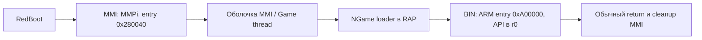

# Этап 7: рабочий контрольный BIN и проверка загрузчика RAP

Пользователь предоставил `BattleGround-1.2.2_P_new.bin` и сообщил, что игра
запускается на консоли. Это первый рабочий контрольный образец в текущем разборе.
Загрузчик NGame из оригинального RAP принимает его в RAM-only ARM-эмуляции:
декодированный payload побайтно совпал с восстановленным host-алгоритмом.
Исследованы startup, private allocator, ранняя инициализация графики и возврат.
Физическая консоль в наших проверках не участвовала.

## Происхождение и границы публикации

| Объект | SHA-256 |
|---|---|
| Оригинальный `8000_MMI.RAP` | `5529b173b3fb612b2e7f516af807f1342d24ea6f7101be034e1e0d08fed25c4e` |
| Загруженная игра | `ffb5dd9fc4f26f299010a78e9be96ab3c7d05c6c64630f68caa21f315ff2e017` |
| Декодированный payload игры, только локально | `f312eafba8f7dbf93afb5897ed127d1081e929181b15386bbaf191912ab539da` |

Опубликованы собственные инструменты, метаданные, адреса и результаты проверок.
Бинарник, декодированный payload, ресурсы, EXIF, Ghidra database и C/ASM игры
сохранены вне публичного checkout. В Ghidra 12.2 / JDK 25 повторно разобраны
7 выбранных функций игры. Число публично экспортированных функций OEM-прошивки
остаётся 284, число typed native declarations — 28.

## Что подтверждает рабочий файл

| Поле | Наблюдение |
|---|---|
| Размер всего файла | 3 400 494, `0x33E32E` |
| Заголовок | `NGame1.0`, 128 байт |
| Payload без заголовка и extra tail | 3 375 568, `0x3381D0` |
| Extra tail, размер из header +0x78 | 24 798, `0x60DE`; JPEG |
| LCM index, header +0x6D | 5; смысл/выбор панели полностью не восстановлен |
| Transform | Первые 1024 байта, ключ/режим из оригинального RAP |
| Footer span | `[0xD381C0,0xD381D0)`, маркер совпал |
| ARM entry / переданный API | `0xA00000`, `r0 = 0x5EFB74` |

Рабочая игра связывает две уже исследованные части пути:



Игра не определяет, какой из пяти PRAW-вариантов RedBoot использует эта плата.
Поля, которые загрузчик не использует на исследованном пути, не объявляются
универсальными требованиями к будущему контейнеру. Причина прежнего отказа
экспериментального `MMI_DIAG.bin` этим сравнением ещё не установлена.

## Startup и память

Игра сохраняет полученный API pointer по `0xD3E000`, очищает собственный BSS
словами, выравнивает начало heap вверх до 1024 байт и вызывает собственный main
`0xA322E0`. Код сохраняет стек вызывающего потока и восстанавливает его при
возврате. Отдельный stack switch или ELF loader для BSS здесь не нужен.

| Диапазон, конец исключён | Назначение / уверенность |
|---|---|
| `[0xA00000,0xD381D0)` | Декодированный payload, включая ресурсы/footer |
| `[0xD381D0,0xD3E000)` | Промежуток до BSS; консервативно резервируем |
| `[0xD3E000,0xD3EF0C)` | Реальная startup-очистка: `0xF0C` байт, 963 слова |
| `[0xD3EF0C,0xD3F60C)` | `0x700` байт до литерала linker end; назначение не установлено |
| `[0xD3F60C,0xD3F800)` | Промежуток выравнивания heap |
| `[0xD3F800,0xE00000)` | Арена собственного allocator игры |
| `[0xF00000,0x1032000)` | Консервативный reserve звукового workspace/tonelib из этапа 5 |

Private allocator создаёт пять классов блоков: 128×32, 512×32, 2048×8,
16384×4, 32768×2, с 16 байтами overhead на блок. После них находятся general
heap metadata по `0xD68CE0`; наблюдённое первое выделение 150 КиБ возвращает
`0xD68D20`. Это адреса **данной игры**, не универсальные свободные участки RAM
для SPMP-OS. MMI general heap и private allocator игры — отдельные интерфейсы.

Загрузчик сначала читает **весь** контейнер в `[0xA00000,0xD3E32E)`, затем
сдвигает `file_size - 128` байт вместе с JPEG tail вниз. Сдвинутая копия
заканчивается на `0xD3E2AE`; последние 128 байт исходного чтения также остаются
в RAM до перезаписи. Это временно пересекает будущий BSS, который затем
очищается приложением. Временный tail нельзя считать постоянным runtime
ресурсом или основанием для запрета BSS в этом месте.

`control_game_inspect.py` сравнивает эти реальные диапазоны с allocation/LCD/
framebuffer/stack assumptions из этапа 6. Результат `model_consistent` относится
к **синтетическому** сценарию выделений. Capture адресов с устройства пока нет.

## Наблюдённая последовательность API

До первого input poll исполнены следующие вызовы. Аргументы получены из ARM VM,
а инструкции вызовов сверены с приватным дизассемблером Ghidra.

| API offset | Наблюдение |
|---|---|
| `+0x038` InitGraph | Игра передаёт buffer `0xD68D20`, size `0x25800`; исследованная функция MMI не читает эти входные аргументы |
| `+0x090` | 320×240; аргументы не означают изменение физических размеров LCD |
| `+0x054` | Указатель на `{0,0,320,240}`; в MMI ранее доказано чтение origin prefix |
| `+0x08C` | `r0 = 32`; полный контракт этого слота пока не типизирован |
| `+0x044` | Чёрный RGB `{0,0,0}` |
| `+0x03C` | ROP `0xF0` |
| `+0x0C4` | FillRect `{0,0,320,240}` |
| `+0x010` | Paint |
| `+0x0D4` | InitRes: `r0 = 3`, `r1 = 0xD33820`; MMI игнорирует первый аргумент |
| `+0x124` | Время; в VM подставлено 1000 |
| `+0x100` | Key output, битовое поле в +4 |
| `+0x108` | Bare-return stub в этой MMI |

Таблица ресурсов: 21 запись по 20 байт и `TAEND` по `0xD339C4`.
Найдены 12 WAV и 9 MIDI; все WAV — PCM, mono, 8000 Hz, 8 bit.
Это согласуется с ограничениями оригинального WAV-пути из этапа 5.

Для ограниченной проверки main на первом poll подставлен бит `0x80000`.
Игра дошла до ветки выхода, вызвала StopRes дважды с нулевыми масками и
вернулась. Entry после main всегда выдаёт `r0 = 0`; отдельный тест с main,
возвращающим `0xDEADBEEF`, подтвердил это. SP и r4–r11 восстановлены в обоих
сценариях. До раннего выхода вызова EnableDoubleBuffer `+0xA8` нет; это ничего
не утверждает о последующем gameplay.

## Воспроизводимость и ограничения

`evidence/control_game_verified.json` содержит static observations и memory
comparison; `evidence/control_game_arm_emulation.json` — loader/startup traces.

В loader VM действительно исполняются header parser, prefix transform, crypto
helpers, footer compare и ветвления `0x4617E4`. Подменены file-read wrapper,
большой overlapping header copy, выделение/освобождение 1024-байтного scratch,
RTOS delay и diagnostic stub. Малые memcpy исполняются из оригинального RAP.
Лимит: 20 млн инструкций / 30 секунд. Все backend игры в двух startup-сценариях
подменены; лимит каждого — 1 млн инструкций / 10 секунд. MMIO не отображены.
Успех не подтверждает реальную графику, audio, IRQ/cache или RTOS scheduling.

```sh
# $GAME и $RAP — локальные неизменённые пользовательские файлы.
python3 research/boot_reconstruction/tools/control_game_inspect.py "$GAME" \
  --allocation-profile research/boot_reconstruction/examples/native_memory_profile.json
python3 research/boot_reconstruction/tools/emulate_control_game.py \
  --game "$GAME" --rap "$RAP" --output /tmp/control-game-results.json
make -C research/boot_reconstruction test
SPMP_CONTROL_GAME="$GAME" SPMP_MMI_RAP="$RAP" \
  python3 -m unittest discover -s research/boot_reconstruction/tests -v
```

ARM-проверки требуют `requirements-emulation.txt`. Приватный Ghidra import
воспроизводится `tools/run_control_ghidra.py --game ... --private-work ...
--ghidra ... --jdk ...`: нужен новый пустой workspace вне публичного checkout.
Runner проверяет SHA игры; Java pre-script проверяет SHA всего payload.
`ARM:LE:32:v5t / apcs` — выбранный профиль анализа raw code, не восстановленные
ELF attributes или доказательство конкретного компилятора. Разделение памяти
по `0xA3B6AC` также является границей анализа, а не исходной секцией ELF.

Проверки: 61 Python-тест, из них 3 optional private; без private файлов 58 PASS
и 3 SKIP, с локальными RAP/игрой — 61 PASS. Три C-модели, host probe и typed
adapter проходят прежние проверки. Новый deployable BIN/Flash image не создан.

## Следующий шаг для SPMP-OS

Использовать подтверждённые entry/API/BSS/return правила при разработке
собственного startup и linker layout, с независимыми пределами размеров
SPMP-OS. Диапазоны heap игры нельзя переносить как обнаруженную свободную RAM.
Далее нужны проверка runtime allocations/stack на плате и разбор недостающих
слотов и нижних LCD/IRQ/cache backend. Текущая host/ARM-object база SPMP-OS
ещё не стала запускаемым приложением консоли. Для полной реконструкции RedBoot
и RAP остаются незавершённые функции и board-dependent ветви.
