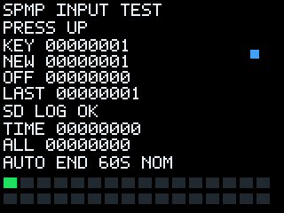

# SPMP_INPUT_TEST.bin — кнопки, курсор, меню и журнал SD

Статус: **VM_TESTED_ONLY**. Предыдущий пакет с тремя полосами проверен
пользователем на консоли; новый интерактивный пакет и запись на SD ещё требуют
проверки на устройстве. Профиль рассчитан на предоставленный `8000_MMI.RAP`.
Это RAM-приложение под штатной MMI, без изменения RedBoot/RAP/NAND/ROMFS.



## Как пользоваться

1. Скопируйте **SPMP_INPUT_TEST.bin** на SD и запустите через штатное меню.
2. На надписи **RELEASE BUTTONS** отпустите кнопку запуска и остальные кнопки.
   Если они не отпущены, приложение завершится примерно через 3 секунды.
3. Следуйте **PRESS UP**, затем DOWN, LEFT, RIGHT, A, B, X, Y, L, R, START,
   SELECT, BACK. На каждую подсказку даётся примерно 4 секунды. Нажмите
   соответствующую кнопку и отпустите. Если такой кнопки нет — дождитесь следующей.
4. Первая ненулевая маска после полного отпускания записывается как SAMPLE
   текущей подсказки. Метка — указание оператору, а не автоматическое определение
   физической кнопки. Неправильное нажатие сохранится именно как кандидат.
5. В заключительной части доступны LIVE/MAP/EXIT, если получены различимые
   образцы UP, DOWN и A. Переключение — записанными UP/DOWN, выбор — записанной A.
   MAP показывает направления и A; полный набор есть в CSV. При неполной карте
   остаётся свободный просмотр масок. Независимо от меню действует автовыход.

Обычный сеанс длится **около 60 секунд** по штатной функции времени MMI.
Отдельный предел — 3000 основных опросов, даже если таймер не продвигается.
Это не watchdog: предел не прерывает зависший системный вызов. Частота таймера
и реальные интервалы отдельно на плате пока не измерялись.

KEY — текущая маска, NEW/OFF — последнее изменение, LAST — последнее ненулевое
состояние, ALL — накопленные биты. Нижняя сетка показывает 32 бита. Курсор
использует записанные направления, пока их нет — номинальные биты 1/2/4/8.
Перерисовываются изменившиеся строки, а не весь экран при каждом опросе.

## Где журнал

**В корне SD: `SPMPKEYS.CSV`.** Путь этой версии RAP:
`/fat20a1/hda1/SPMPKEYS.CSV`. Он не зависит от каталога BIN.

- Новая сессия добавляется в конец. Предыдущие данные не обнуляются.
- Перед каждой записью выполняется seek к концу; затем предпринимается закрытие
  файла. Успешный close учитывается как сохранённая запись.
- Ошибка SD отключает дальнейшую запись этого сеанса, но экран/опрос продолжаются.
- Максимум новых данных — 64 КиБ за запуск, общий журнал ограничен 1 МиБ.
  При LIMIT сохраните/переименуйте журнал на ПК перед следующим тестом.
- Нет подстановки внутренней памяти вместо недоступной SD и нет удаления файлов.

На экране: **SD LOG CHECK**, затем **SD LOG OK** либо OPEN/SEEK/WRITE/CLOSE ERROR,
LOG LIMIT. При ошибке в журнале может остаться неполная строка; следующий запуск
начинает с новой строки и новой метки сессии.

CSV содержит:

```text
event,poll_hex,time_hex,prompt,mask_hex,pressed_hex,released_hex
KEY,00000001,00000014,UP,00000001,00000001,00000000
SAMPLE,00000001,00000014,UP,00000001,00000001,00000000
```

Все числовые поля — HEX. События ARM/PROMPT/KEY/SAMPLE/MENU/END/END_ERROR
разделяют отпускание запуска, подсказки, переходы, выбор меню и завершение.
В заголовке есть версия приложения и ожидаемый профиль RAP. Маски возвращены
**MMI GetKeys**, а не прямым чтением GPIO. Часть системных кнопок обрабатывает
сама MMI; отсутствие их в CSV не доказывает неисправность.

Для сравнения разных устройств сохраняйте их журналы под отдельными именами
на ПК. У приложения нет независимо проверенного hardware ID. Обычный лог
содержит отдельные сессии, которые не объединяются в одну карту.

## Разобрать файл на ПК

В скачанном artifact:

```sh
python3 tools/input_log_decode.py SPMPKEYS.CSV --device Defender --output keys.json
```

В checkout репозитория:

```sh
python3 research/boot_reconstruction/tools/input_log_decode.py SPMPKEYS.CSV \
  --device "Defender MultiMix Magic" --output keys.json
```

JSON содержит отдельные сессии, события и `candidate_mappings`. Имя устройства
вводит пользователь. Эти кандидаты автоматически в SPMP-OS не применяются.
`example.csv` и `example_decoded.json` внутри artifact получены в синтетической
VM, не на реальном устройстве.

## Проверки и сборка

```sh
make -C research/boot_reconstruction test
make -C research/boot_reconstruction arm-input-check ARM_VM_PYTHON=/path/to/venv/bin/python
```

73 Python-теста, host C-тест SD/error/partial-write/timer-wrap, 19 сценариев
собранного ARM-кода с виртуальной SD; три запуска нового пакета через настоящий
код RAP с подставными backend; 20 отдельных ARM-проверок файловых функций и
таймера. Физическая запись на SD, длительная работа и поведение кнопок ещё
не подтверждены. Новая сборка не получает hardware-статус старого one-frame BIN.

[Отчёт этапа 10](https://github.com/kozinenko2-lab/SPMP-OS/blob/main/research/boot_reconstruction/STAGE10_REPORT_RU.md).
