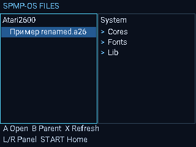

# SPMP-OS FILES — две панели и прямой Roboto TTF

**SPMP_OS_FILES.bin** — новая RAM-сборка SPMP-OS под штатной MMI.
Статус: **VM_TESTED_ONLY**. Пакет использует настоящий FM01 model, измеренный
профиль кнопок вашей консоли и новые directory/stat bindings точного RAP.
На этом этапе реализован просмотр каталогов и сведений о файлах.
Копирование/перемещение/удаление/переименование FM02 ещё не включены.

## Установка

В скачанном artifact найдите **build/mmi_files/SPMP-OS-SD.zip** и распакуйте
его **содержимое в корень SD**. Нужны BIN и дерево каталогов вместе:

```text
SD:/
  SPMP_OS_FILES.bin
  SPMP-OS/
    System/
      Fonts/Roboto-Regular.ttf
      Apps/  Cores/Atari2600/  Lib/  Themes/
    User/
      ROMs/Atari2600/  Ports/
      Music/  Video/  Pictures/  Books/
      Saves/Atari2600/  Settings/  Logs/
```

Запустите `SPMP_OS_FILES.bin` обычным способом из заводской оболочки.
Перед запуском отпустите кнопки; клавиатура должна быть разблокирована.
Существующие пользовательские файлы программа автоматически не переносит.
Каталоги `System` и `User` оба расположены на SD; это разделение данных,
а не включение физической встроенной памяти/NAND.

## Управление

| Кнопка | Действие |
|---|---|
| UP/DOWN | Выбрать строку; следующая страница подгружается при выходе курсора за девять строк |
| L/R либо LEFT/RIGHT | Левая/правая панель |
| SELECT | Переключить активную панель |
| A | Открыть каталог; для файла — показать сведения и выбранный путь |
| B | Родительский каталог; в сведениях — назад; в корне SD — главное меню |
| X | Обновить активный каталог после изменений на носителе |
| START | Главное меню Files / Information / Exit |
| Короткое POWER | Собственное меню Continue / Exit |

Нажимайте коротко и отпускайте: действия выполняются по фронту нажатия,
автоповтора пока нет. HOLD в сценарий не входит. Долгое POWER не тестируется.

Левая панель начинает в `SPMP-OS/User`, правая — в `SPMP-OS/System`.
Если этих каталогов нет, панель пытается открыть корень SD. Через B можно
подняться к существующим файлам в других каталогах SD. Ошибка чтения
показывается как Read E с hex-кодом. Список сортируется: папки, затем имена.
Максимум — 4096 записей за обход; подсчёт/сортировка синхронные, отмена ещё
не подключена. Обновление не происходит само: используйте X.

## Шрифт

Roboto Regular **читается напрямую из TTF** в `System/Fonts`. Весь файл не
загружается в RAM: используется 2-КиБ read cache и кэш растеризованных символов.
Один renderer используется в панелях, главном меню, сведениях и POWER-меню.
Information показывает `Font: Roboto TTF`. Если файл отсутствует/некорректен,
появится `Font: built-in fallback`; программа продолжит работать.

TTF остаётся исходным файлом пользователя, 171272 байта, Apache-2.0;
license/notice включены. Собственный TrueType renderer работает с glyf,
cmap4/12 и XY composites, целочисленно, без FPU и heap. В этой сборке 13 px.
Подсказки TrueType, CFF/OTF, сложный shaping и сглаживание ещё не реализованы.
Формат имени файла на реальной FAT/SD отдельно проверяется на устройстве;
UTF-8/кириллица проверены на подставном SD в ARM VM.

## Atari 2600 и журнал

ROM можно положить в `SPMP-OS/User/ROMs/Atari2600` под произвольным именем.
A на `.a26` сейчас показывает сведения и сохраняет выбранный путь. **Игра этим
пакетом ещё не запускается**: Atari player — следующий шаг после проверки FM.
Адаптер z26 уже принимает внешний путь, собирается ARMv5 и прошёл host-тесты
разных имён/каталогов и контрольного Adventure. ROM в архив не включён.

Журнал дописывается в **SPMP-OS/User/Logs/SPMPFM.CSV**, без truncate.
`#FONT` фиксирует TTF/fallback, `#PATH` — выбранный путь, percent-encoded UTF-8.
В файловом виде selection_hex содержит cursor и active-panel в старшем бите.
Ошибки журнала показывают OPEN/SEEK/WRITE/CLOSE/LIMIT и hex errno; навигация
продолжает работать. Программа не перебирает другие носители как fallback.

После проверки пришлите CSV и наблюдения: обе панели, несколько переходов,
русские имена, внешний путь ROM, POWER→Continue/Exit и возврат в штатную MMI.
Автоматический выход — 150000 native time units либо 7500 опросов; реальная
продолжительность и производительность шрифта на консоли ещё не измерены.

## Проверки

Host/FM/TTF tests, ASan/UBSan, ARMv5TE EABI5 soft-float link и публичная VM.
20 compiled ARM cases: navigation/path/panels/refresh, TTF/fallback,
SD/dir/read/stat/close errors, clock wrap/limit, prefix rejection before BSS.
Отдельно выполняется оригинальный RAP loader/collector/normal-return путь;
часы/SD/графика — виртуальные backends. Проверка VM не является аппаратным запуском.


