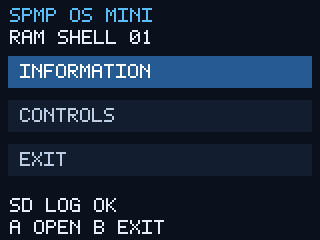

# SPMP OS MINI — первый RAM-прототип оболочки

**SPMP_OS_MINI.bin** запускается как обычное приложение в заводской MMI.
Это минимальное меню на новых модулях `project/spmp-os/src/platform/spmp_mmi_input.c`
и `src/ui/spmp_mmi_shell.c`. Полная SPMP-OS с эмуляторами и файловым менеджером
ещё не перенесена. Статус этой версии: **VM_TESTED_ONLY**.

[Скачать ZIP spmp-os-mini-vm-tested](https://github.com/kozinenko2-lab/SPMP-OS/actions/runs/43552586927/artifacts/14097250186).
Внутри: `build/mmi_shell/SPMP_OS_MINI.bin`, 10896 байт, SHA256
`8d9a4f0f495707a87cd2a91189c686ae72e5eee4e8cc70f7efe5460104f54631`.
Исходная ревизия `d36fa32233d5d6d1c1836af0b0d62395f09df929`.
Артефакт GitHub хранится 14 дней; после истечения можно пересобрать из исходников.

Профиль выбран для консоли пользователя, приславшего SPMPRAW.CSV: 14 кнопок
состояния и отдельное короткое событие POWER. Для других плат карта может
отличаться. HOLD отложена по просьбе пользователя, новых тестов HOLD нет.

## Запуск и управление

1. Скопируйте `SPMP_OS_MINI.bin` из пакета на SD и запустите обычным способом,
   как предыдущий тест. Перед запуском снимите блокировку клавиатуры штатным
   способом и отпустите все кнопки.
2. В главном меню: **UP/DOWN** — выбор, короткое **A** — открыть,
   короткое **B** — выйти. Удержание не повторяет пункты; для следующего
   действия отпустите кнопку и нажмите снова.
3. **INFORMATION** показывает режим запуска и время. **CONTROLS** показывает
   hex-состояние и переведённые кнопки; **B** возвращает в главное меню.
4. Короткое **POWER** открывает собственное меню приложения:
   **CONTINUE / EXIT**. UP/DOWN и A выбирают; B продолжает приложение.
   Это новое меню SPMP-OS, без штатных пунктов сохранения/загрузки.
5. При выходе появится RETURNING TO MMI. Ожидается возврат в заводскую оболочку.

Журнал **SPMPOS.CSV** дописывается в корень SD через `/fat20a0/hda0`, без
перезаписи предыдущего содержимого. При ошибке SD программа показывает стадию
и hex errno; навигация и выход продолжают работать. Можно прислать CSV после
проверки меню, POWER→CONTINUE и POWER→EXIT. Долгое POWER не входит в проверку.

Есть автоматический выход: 150000 единиц штатного таймера либо 7500 опросов,
что наступит раньше. Скорость таймера и задержки на плате отдельно не измерены;
настенные 150 секунд не гарантированы. INPUT LOCKED означает, что установлен
один из штатных флагов блокировки; приложение само их не изменяет.

## Что делает пакет

В каждом опросе дважды читает проверенные RAM-поля состояния/события/блокировки
и один раз вызывает оригинальный collector `0x2d2e6c`. Cooked GetKeys не
вызывается: L/R и громкость остаются разными кнопками, удержание START не
зависит от короткого события. SELECT+VOL± регистрируются как сочетания;
регулировка яркости ещё не реализована. После запуска, снятия блокировки и
POWER нужно отпустить кнопки перед следующим действием.

Графика использует существующие MMI callbacks; журнал — проверенные eCos SD0
службы. Собственных GPIO/MMIO обращений, изменения RedBoot/NAND/ROMFS,
выделения heap, создания потоков и звука в этом прототипе нет.

## Сборка и границы проверки

`make -C project/spmp-os mmi-input-check`

`make -C research/boot_reconstruction arm-shell-check ARM_VM_PYTHON=/path/to/venv/bin/python`

ARMv5TE / EABI5 / soft-float. До BSS проверяются прежние таблица/ABI/память,
CRC выбранных функций и указатели четырёх RAM-полей. Это проверка совместимости
интерфейсов, а не полный SHA образа, загруженного в RAM. Эмуляция подменяет
часы, SD, графику и источник нажатий; аппаратный запуск новой оболочки ещё
не подтверждён. Экран `preview.png` получен эмуляцией.
