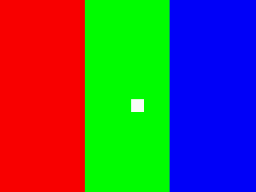

# Минимальный прототип экрана, ввода и возврата

Статус переносимого ядра: **HOST_TESTED / ARM_VM_TESTED**. В составе NGame
artifact 14076639604 пользователь 14 ноября 2026 подтвердил на консоли кадр
с тремя цветными полосами и выход. Кнопки/курсор и длительная работа этим
сообщением отдельно не подтверждены. Ядро рисует RGB565-полосы и курсор,
опрашивает ввод по шагам и запрашивает обычный возврат. Сам этот каталог
не содержит target-entry/binder/linker/package; они добавлены отдельно
в [native_startup](../native_startup/NGAME_README_RU.md).



`preview.png` получен из `build/native_probe_frame.ppm`, который рисует host-код
этого примера. Это диагностический шаблон, не снимок консоли или готовый UI SPMP-OS.

## Файлы и контракты

- `probe.c/.h` — переносимое ядро без libc, файлов, собственного потока и звука.
- `host.c` — два массива пикселей, копирование при present, scripted input,
  ограничение шагов и проверки нормального/ошибочного завершения.
- `oem_adapter.c/.h` — адаптер к типизированным функциям InitGraph, display
  origin, double buffer, dimensions, FG, FillRect, Paint и getKeys.
- `adapter_test.c` — проверка адаптера с **host-функциями**, имеющими OEM-сигнатуры.

Адаптер получает таблицу уже типизированных функций от вызывающего. Resolver
85 числовых слотов не предоставляется: устанавливать живые указатели можно
после проверки образа, ABI и условий запуска. Он проверяет полноту переданной
таблицы, затем вызывает InitGraph → SetDisplayOrigin(0,0) → EnableDoubleBuffer(1).
В VM эта последовательность настройки проверена отдельно от host-приложения.

Кадр перерисовывается на одном `probe_step`. Возврат по quit-mask или max_steps
восстанавливает FG и вызывает finish один раз. В OEM-адаптере finish не вызывает
gameExit, не меняет SP и не обещает восстановить GUI/завершить RTOS-worker:
это остаётся обязанностью проверенного обычного пути возврата приложения.

Стандартная конфигурация примера назначает 1/2/4/8 движению, 0x20000 — выходу.
Это выбранное назначение масок. Физические кнопки Defender ещё не сопоставлены
трассировкой GPIO. У оригинального getKeys есть системные побочные действия,
описанные на этапе 4; host-script их не воспроизводит.

Ошибка begin требует очистки частичной инициализации самим backend. Адаптер не
сертифицирует возможность отката произвольной ошибки OEM InitGraph. FillRect
OEM скрывает timeout GPU, поэтому успешный status ещё не удостоверяет завершение
рисования. Эти ограничения запрещают считать тесты готовым HAL для устройства.

## Сборка

Из корня репозитория:

```sh
make -C research/boot_reconstruction test
research/boot_reconstruction/build/native_probe_host \
  --frame research/boot_reconstruction/build/native_probe_frame.ppm

# clang + llvm-nm + llvm-readelf; создаются только два ET_REL object.
make -C research/boot_reconstruction arm-probe
```

ARM: little-endian, ARMv5TE, EABI5, soft-float. Проверяются ELF32/ARM/ET_REL/EABI5,
отсутствие hard-float flag и undefined symbols в обоих object; это не связывание полноценной программы и не проверка
вызовов на ARM. Пример раскладки памяти:
[`../native_memory_profile.json`](../native_memory_profile.json).
Его размеры payload/BSS/heap заданы для иллюстрации и не измерены по этим object.
CI сохраняет object и host PPM в artifact `native-probe-armv5-objects` на 14 дней.

Рабочий OEM BIN исследован на этапе 7. На [этапе 8](../../STAGE8_REPORT_RU.md)
ядро и adapter связаны с новым startup в отдельный ARM VM fixture; его callbacks
синтетические. Сам этот переносимый модуль не содержит native entry/binder.
Для device-варианта остаются проверка image identity при binding, cache/IRQ ABI,
живые границы allocation/стека, packing и подтверждённое завершение штатных потоков.
