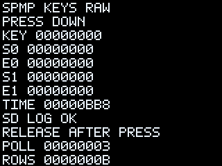

# SPMP_KEYS_RAW.bin — входные состояния, POWER и HOLD

**Обновление этапа 14:** пользователь прислал два полных RAW-сеанса.
Штатное POWER-меню в RAW_R1, по его сообщению, не появлялось, блокировка
проявилась после выхода. HOLD отложена; дальнейшая работа — минимальная
[оболочка SPMP OS MINI](../mmi_shell/README_RU.md). Ниже сохранена исходная
инструкция RAW_R1; повторять HOLD-проверку сейчас не требуется.

Новый RAM NGame, статус **VM_TESTED_ONLY**. Предыдущий пакет SD0 сохранил журнал
на консоли; новый наблюдатель, HOLD и POWER ещё требуют аппаратной проверки.
Профиль только для предоставленного `8000_MMI.RAP`. Штатный запуск и RedBoot
не изменяются. Наблюдатель читает RAM MMI, это не прямое чтение GPIO.



## Запуск и подсказки

Из ZIP возьмите `build/raw_input/SPMP_KEYS_RAW.bin`, скопируйте на SD и запустите.
Перед запуском разблокируйте клавиатуру обычным HOLD. На **RELEASE BUTTONS**
отпустите кнопку запуска и остальные кнопки. Ожидание отпускания ограничено
150 опросами/3000 native units; затем приложение выходит.

В этом тесте **16 органов управления**: четыре направления, A/B/X/Y, L/R,
START/SELECT, HOLD, POWER и VOL+/VOL−. MENU как отдельной кнопки нет.
BACK в предыдущем тесте соответствует короткому POWER; HOLD — другая кнопка.

1. **UP → DOWN → LEFT → RIGHT → A → B → X → Y → L → R → START → SELECT**:
   на каждую подсказку около 3 секунд. Нажмите, подержите примерно секунду
   и отпустите. Пропускайте только отсутствующие на другом устройстве кнопки.
2. **HOLD SHORT**: коротко нажмите HOLD и отпустите; окно около 3 секунд.
3. **VOL PLUS**, затем **VOL MINUS**: отдельно нажмите + и −, по 3 секунды.
   Они не считаются L/R. Штатная MMI может менять громкость при этих нажатиях.
4. **SELECT AND VOL PLUS**, затем **SELECT AND VOL MINUS**: удерживая SELECT,
   коротко нажмите соответствующую громкость, затем отпустите обе кнопки.
   Каждое окно около 4 секунд. Это измерение сочетаний: яркость не изменяется.
5. **LONG HOLD TO LOCK**: удержите HOLD до штатной блокировки, отпустите.
   **LONG HOLD TO UNLOCK**: повторите долгое HOLD для разблокировки.
   На каждую подсказку около 6 секунд. Штатный механизм блокировки не отключается.
6. **POWER SHORT ONLY**: только короткое POWER. В стандартном меню приложений/
   эмуляторов выберите **«Продолжить»**. Долгое POWER выключает консоль и
   **в сценарий не входит**. POWER поставлен последним; его окно около 5 секунд.
7. После этого FREE INPUT и автоматическое завершение.

Общий предел — **80000 native units**, номинально около 80 секунд, либо
4000 основных опросов. Таймер MMI не является независимо измеренным секундомером.
При открытом штатном меню время продолжает идти: после «Продолжить» тест может
сразу закончиться. Ограничения не прерывают зависший системный вызов; watchdog
не заявляется. Выбор «Выйти» в штатном меню может оставить сеанс без END.

## Экран и файл

- KEY — результат штатного игрового GetKeys после фильтрации.
- S0/E0 — state/event RAM перед GetKeys, S1/E1 — после. Это разные слои,
  их значения нельзя складывать в универсальный код кнопки.
- TIME/POLL/ROWS — native time, опросы и успешно закрытые записи; числа HEX.
- SD LOG OK либо SD OPEN/SEEK/WRITE/CLOSE E и восьмизначный errno.

Журнал — **`SPMPRAW.CSV` в корне SD**, абсолютный путь
`/fat20a0/hda0/SPMPRAW.CSV`. Старый `SPMPKEYS.CSV` не используется этим пакетом.
Сеансы дописываются; каждый успешный open завершается попыткой close. Пределы:
64 КиБ новых данных за запуск, 1 МиБ на файл. Ошибка записи отключает logging,
но опрос/экран продолжаются. Нет перебора носителей и внутреннего fallback.

Событие **PRE** сохраняется до GetKeys при изменении входного состояния: это
даёт шанс сохранить POWER перед переходом в меню. Его cooked/after поля равны
**NA**, потому что вызов ещё не выполнен. SAMPLE содержит пару before/after;
TICK — периодическую запись даже без изменений, GAP — вызов GetKeys дольше
1000 units. Есть PROMPT и END/END_ERROR. Две RAM-ячейки читаются последовательно,
поэтому пары не являются атомарным снимком. Между PRE и вызовом есть файловый IO;
непосредственно перед GetKeys выполняется ещё одно чтение.

Если MMI обработала кнопку раньше этих RAM-переменных, она всё ещё может не
появиться в журнале. Физические названия — инструкция оператору, не распознавание.
Полную карту и поведение HOLD/POWER нельзя обещать до файла с консоли.

## Разбор на ПК

В artifact:

```sh
python3 tools/raw_log_decode.py SPMPRAW.CSV --device "Defender user console" --output raw.json
```

В репозитории:

```sh
python3 research/boot_reconstruction/tools/raw_log_decode.py SPMPRAW.CSV --output raw.json
```

`observed_masks_by_prompt` хранит разные слои отдельно. ARM/FREE не превращаются
в кандидатные назначения; автоматического переназначения кнопок нет. После
теста пришлите CSV и укажите, появились ли штатные блокировка/разблокировка HOLD
и меню короткого POWER. `example.csv`, JSON и preview в ZIP — синтетические.

[Технический отчёт](https://github.com/kozinenko2-lab/SPMP-OS/blob/main/research/boot_reconstruction/STAGE13_REPORT_RU.md).
